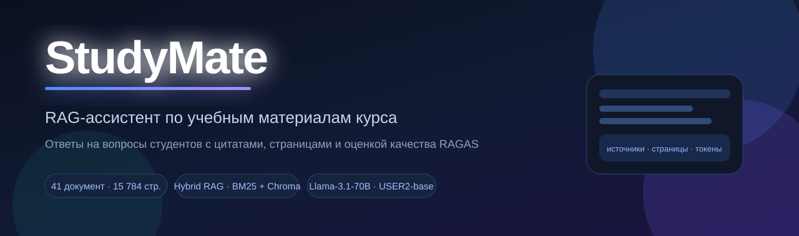
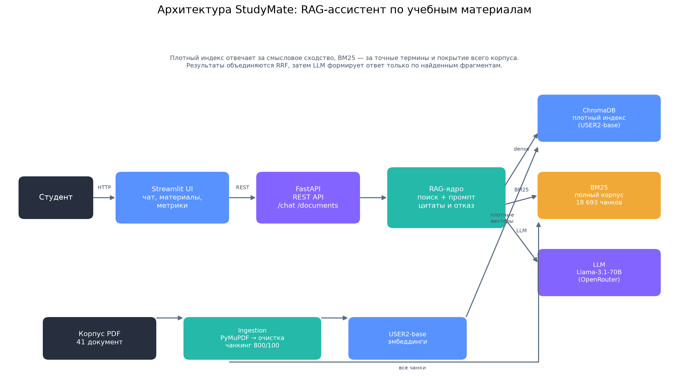
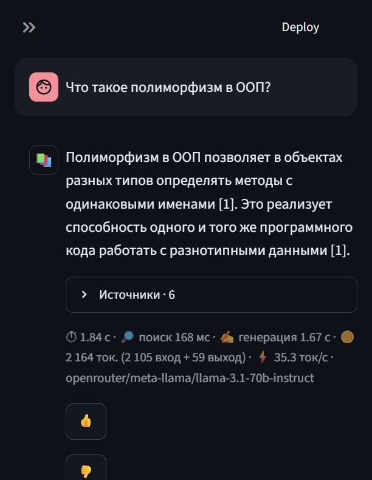
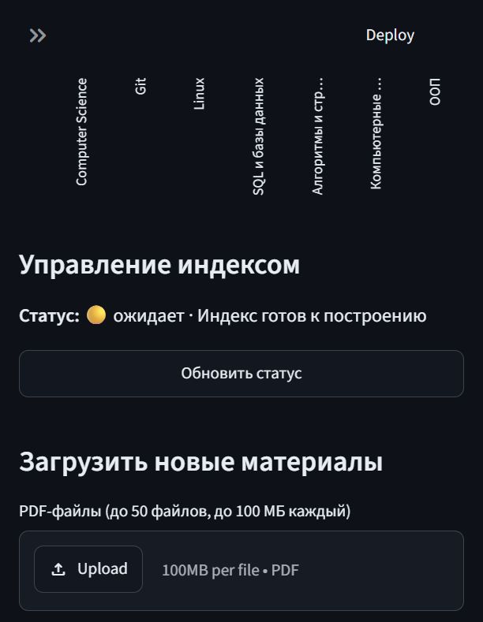
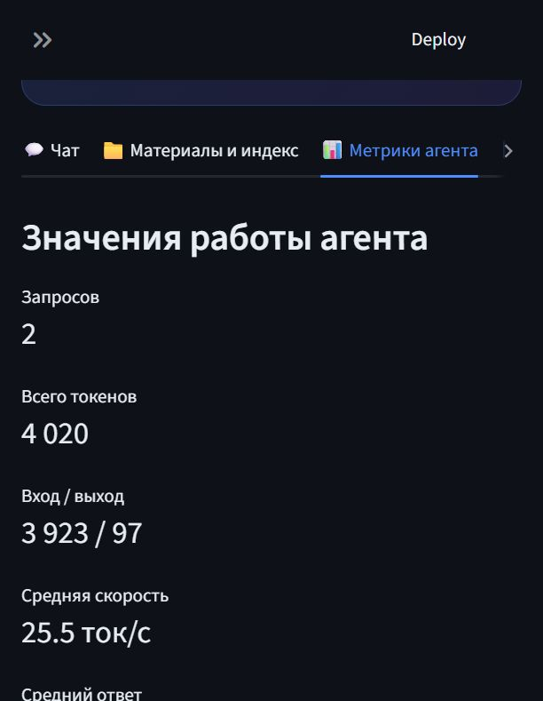
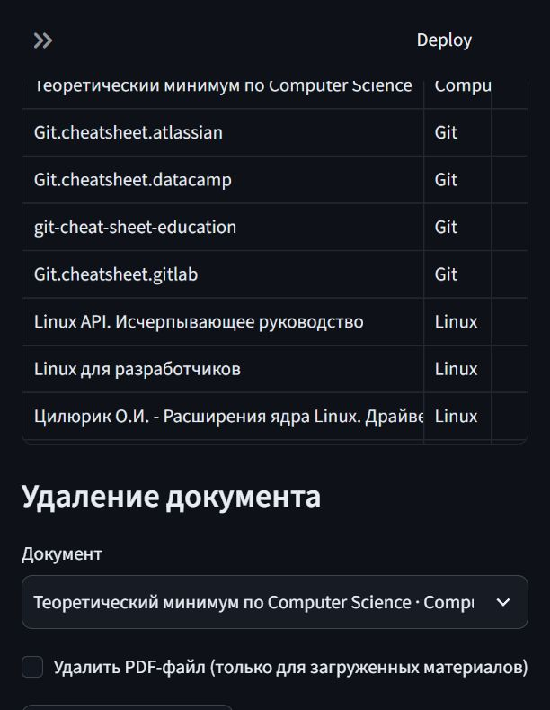

<p align="center">
  
</p>

<p align="center">
  <a href="https://github.com/evangreen165/studymate-rag/actions/workflows/ci.yml"></a>
  
  
  
  
</p>

# StudyMate

**RAG-ассистент по учебным материалам курса.** Отвечает на вопросы студентов по PDF-конспектам, опирается только на найденные фрагменты и показывает источники с номерами страниц. Умеет работать с корпусом из 41 документа, загружать новые материалы, переиндексировать корпус и показывать метрики работы агента: токены, токены в секунду, задержки поиска и генерации.

> Курсовая работа по дисциплине «Прикладные интеллектуальные системы», БГУИР, 2026/2027.
> Тема: «Ассистент по учебным материалам курса с ответами на вопросы студентов».

## Содержание

- [Зачем это нужно](#зачем-это-нужно)
- [Что умеет](#что-умеет)
- [Архитектура](#архитектура)
- [Быстрый старт](#быстрый-старт)
- [Интерфейс](#интерфейс)
- [API](#api)
- [Оценка качества](#оценка-качества)
- [Структура репозитория](#структура-репозитория)
- [Ограничения](#ограничения)
- [Документация](#документация)
- [Лицензия](#лицензия)

## Зачем это нужно

Студенту нужно быстро найти ответ в десятках PDF: конспектах, методичках и учебниках. Обычный чат-бот без доступа к материалам отвечает «по памяти» и ошибается, а полнотекстовый поиск не понимает смысл вопроса. StudyMate решает обе проблемы: находит релевантные фрагменты гибридным поиском (плотные эмбеддинги + BM25), передаёт их LLM и требует от модели отвечать только по контексту со ссылками.

## Что умеет

- **Отвечает с опорой на источники.** В ответе — цитаты `[1]`, `[2]`, карточки источников с документом, страницей и оценкой релевантности.
- **Честно отказывается.** Если в материалах нет ответа, ассистент говорит об этом, а не выдумывает.
- **Гибридный поиск.** Плотный индекс ChromaDB (USER2-base) + BM25 по всему корпусу, объединение через RRF и MMR.
- **Управляет корпусом из UI.** Список документов, темы, статусы, загрузка новых PDF, запуск и отмена индексации, удаление документов.
- **Показывает работу агента.** Токены (вход/выход/всего), токены в секунду, время поиска, генерации и ответа, модель и провайдер.
- **История чатов.** Несколько диалогов, автозаголовки, экспорт в Markdown, сохранение между перезапусками.
- **Два провайдера LLM.** OpenRouter (Llama-3.1-70B) и локальная GGUF-модель Qwen2.5-7B как резерв; mock-провайдер для тестов.
- **REST API и OpenAPI.** FastAPI, валидация, коды ошибок, `/health`, `/ready`, `/metrics` для Prometheus, JSON-логи.
- **Воспроизводимость.** Docker Compose, GitHub Actions, тесты, фиксированные версии зависимостей, манифест корпуса с SHA256.

## Архитектура

<p align="center">
  
</p>

**Поток данных.** PDF → PyMuPDF → очистка → чанкинг (800 токенов USER2, overlap 100) → стратифицированная подвыборка для плотного индекса (до 25 чанков на документ) → USER2-base → ChromaDB. Все чанки попадают в BM25-корпус. Запрос: эмбеддинг вопроса → dense top-k + MMR и BM25 top-k → RRF → промпт с цитатами → LLM → ответ + источники.

Почему гибрид: плотный поиск находит смысловые совпадения, BM25 — точные термины, команды и формулы. Полный BM25-корпус покрывает все 41 документ, плотный индекс ограничен 794 стратифицированными чанками — это осознанный компромисс по CPU-бюджету, зафиксированный в пояснительной записке.

## Быстрый старт

### Docker (одна команда)

```bash
cp .env.example .env
# впишите OPENROUTER_API_KEY
docker compose up --build
```

- UI: http://localhost:8501
- Swagger: http://localhost:8000/docs
- Health: http://localhost:8000/health

При первом запуске контейнер собирает демонстрационный индекс из 7 синтетических конспектов (CC BY 4.0). Полный корпус из 41 PDF в публичный репозиторий не входит по условиям авторских прав — см. [data/README.md](data/README.md).

### Локально

```bash
uv sync
cp .env.example .env
uv run python scripts/make_demo_corpus.py
uv run python scripts/build_index.py --demo
uv run uvicorn studymate.api.main:app --port 8000
uv run streamlit run app/ui/streamlit_app.py
```

Требуется Python 3.12 (uv поставит его сам). Для полного корпуса положите PDF в тематические папки `data/` и выполните:

```bash
uv run python scripts/build_manifest.py
uv run python scripts/build_index.py --skip-manifest
```

Индексация полного корпуса на CPU занимает около 40 минут: 18 693 чанков BM25 и 794 плотных векторов.

## Интерфейс

<p align="center">
  
  
</p>

<p align="center">
  
  
</p>

В чате видны источники, задержки, токены и скорость; во вкладке «Материалы» — загрузка PDF, прогресс индексации, удаление документов; во вкладке «Метрики» — журнал запросов и сводные показатели.

## API

| Метод | Путь | Назначение |
| --- | --- | --- |
| `GET` | `/health` | статус сервиса |
| `GET` | `/ready` | готовность индекса |
| `POST` | `/chat` | вопрос → ответ + источники |
| `GET` | `/documents` | документы корпуса и статусы |
| `GET` | `/topics` | темы и число документов |
| `POST` | `/corpus/upload` | загрузка PDF |
| `DELETE` | `/corpus/documents/{id}` | удаление документа |
| `POST` | `/index` | запуск индексации |
| `GET` | `/index/status` | прогресс индексации |
| `GET` | `/stats` | статистика индекса и провайдеров |
| `GET` | `/metrics` | Prometheus-метрики |
| `GET` | `/docs` | OpenAPI/Swagger |

Пример:

```bash
curl -X POST http://localhost:8000/chat \
  -H "Content-Type: application/json" \
  -d '{"question":"Чем отличается git merge от git rebase?","top_k":5}'
```

## Оценка качества

Оценка проводится на отложенной тестовой выборке из 30 вопросов (по 4–5 на тему) с эталонными ответами. Используется RAGAS 0.3.9, судья — Llama-3.1-70B, эмбеддинги — USER2-base. Baseline — та же LLM без поиска по документам.

<!-- METRICS_TABLE -->

| Метрика | RAG | Baseline (LLM без поиска) | Цель |
| --- | ---: | ---: | ---: |
| Faithfulness | 0.885 | — | ≥ 0,80 |
| Answer Relevancy | 0.807 | 0.858 | ≥ 0,75 |
| Context Precision | 0.650 | — | — |
| Context Recall | 0.778 | — | — |
| Answer Correctness | 0.517 | 0.447 | — |
| Gold hit (top-k) | 0.633 | — | — |

*p50 = 1.78 с, p95 = 2.35 с, RPS = 1.40.*


## Структура репозитория

```text
.
├── src/studymate/          # RAG-ядро, API, индексация, оценка
├── app/ui/                 # Streamlit-интерфейс и история чатов
├── scripts/                # сборка корпуса, индекса, оценка, документы
├── tests/                  # unit/integration тесты
├── data/
│   ├── demo/               # 7 синтетических PDF (CC BY 4.0)
│   ├── eval/               # val/test вопросы с эталонами
│   ├── manifest.json       # паспорт полного корпуса (без PDF)
│   └── passport.md         # EDA и статистика корпуса
├── docs/
│   ├── pz/                 # пояснительная записка (.docx/.pdf)
│   ├── graphics/           # 4 листа А4 по ГОСТ 19.701
│   ├── presentation/       # презентация защиты
│   └── site/               # GitHub Pages
├── docker/                 # entrypoint
├── Dockerfile
├── docker-compose.yml
└── pyproject.toml
```

## Ограничения

- PDF-сканы без текстового слоя не индексируются; они видны в UI со статусом `scanned`.
- Формулы, таблицы и листинги кода из PDF могут терять структуру.
- Плотный индекс построен по стратифицированной подвыборке (до 25 чанков на документ), полный текст покрывается BM25.
- LLM может ошибаться; источники нужно проверять.
- Полный корпус и локальная GGUF-модель не публикуются в Git.

## Документация

- [Пояснительная записка](docs/pz) — 30–50 страниц по СТП 01-2024.
- [Графическая часть](docs/graphics) — 4 листа А4.
- [Презентация](docs/presentation) — 15 слайдов.
- [GitHub Pages](https://evangreen165.github.io/studymate-rag/) — краткая страница проекта.
- [data/README.md](data/README.md) — как собрать полный корпус.

## Лицензия

Код — MIT. Демонстрационный корпус — CC BY 4.0. Полные учебные PDF не распространяются.
